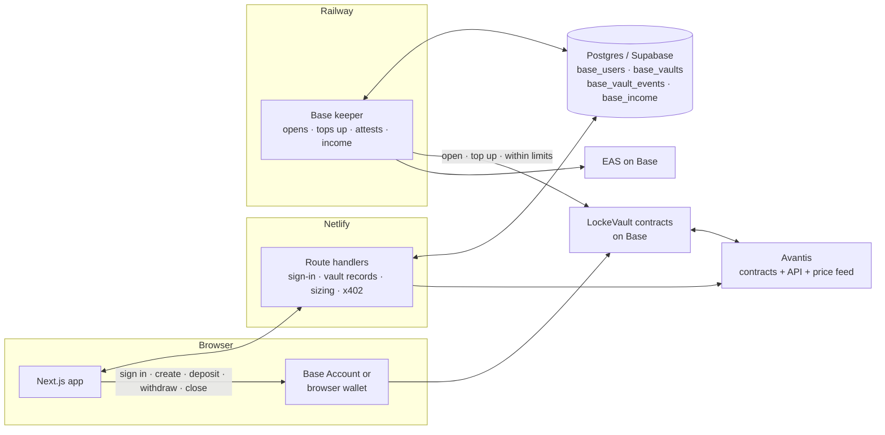

# Locke

**Protect what your business holds. Manage what it buys, with hedges and from a vault you own.**

Locke helps businesses on Base manage price risk with perpetual futures on [Avantis](https://www.avantisfi.com) (now operating as Veranta). A business tells Locke what it wants to protect — crypto it holds, or the fuel it buys every month — and Locke sizes the hedge, opens it from a vault contract the business owns, and keeps its margin topped up.

| Plan | Protects against | Avantis market | Side | Hedge quality |
|---|---|---|---|---|
| **Holdings** | A fall in the value of ETH or BTC held | `ETH/USD`, `BTC/USD` | Short | Direct: the hedge tracks the same asset |
| **Operating costs** | A rise in fuel costs | `WTI/USD`, `BRENT/USD` | Long | Partial: crude explains only part of local fuel prices |

Every vault follows the same path: **describe exposure → preview the hedge and its costs → create and fund the vault → the keeper opens and watches the hedge → withdraw or close from your own wallet.**

Locke is not a trading terminal. Every screen is about an exposure the business already has.

## What it does

- **Sign in with Base.** Base Account (Coinbase Wallet) or any EVM wallet in the browser signs a Sign-In with Ethereum message. No transaction, no gas.
- **A vault per plan.** The business's wallet approves USDC and calls `createVault` in one batch. The `LockeVault` contract (see `contracts/`) holds the USDC and is the trader on Avantis, so every payout comes back to it. Only the owner can withdraw.
- **Limits on chain.** The vault caps market, side, leverage, hedge size and slippage. Locke's keeper can trade only within them and can never withdraw.
- **Margin kept topped up.** The keeper opens the hedge once the deposit is in and adds margin from the vault's buffer when margin use reaches 60%, back to about 35%.
- **Exit any time.** Deposit, withdraw, close the hedge and remove the keeper all go straight from the owner's wallet to the vault, even if Locke is offline.
- **Protected by Locke.** While a hedge is open, an [EAS](https://attest.org) attestation on Base says so; `/proof/[uid]` reads it straight from EAS.
- **Protect as you get paid.** Optionally, the owner's Base Account signs one spend permission so a share of incoming USDC moves into the vault, never more per week than the cap.
- **Agent API (x402).** AI agents and on-chain treasuries can quote and open vaults, paid per call in USDC on Base.
- **Builder Codes.** Every transaction from the app and the keeper carries Locke's Base Builder Code (ERC-8021) when `BASE_BUILDER_CODE` is set.

### Risk levels

Margin use is maintenance ÷ equity: 100% is exactly Avantis's liquidation (losses and fees reaching 85% of the collateral).

| Level | Margin use | What happens |
|---|---|---|
| Watch | 50% | The vault shows amber |
| Action | 60% | The keeper adds margin from the buffer, back to about 35% |
| Buffer used up | 60%+ | The vault page says how much USDC to add, or to close part of the hedge |
| Liquidation | 100% | Avantis closes the position; what's left stays in the vault |

## Pages

A **plan** is what a business sets up; each plan's USDC sits in its own **vault** contract on Base. The old `/base…` addresses redirect to `/plans…`.

| Route | What it is |
|---|---|
| `/` | Home, with live prices from Avantis (ETH, BTC, WTI, Brent) |
| `/how-it-works` | The four steps, both plan types, the margin ladder, and how a vault works |
| `/connect` | Sign in with Base |
| `/plans` | Your plans (signs you in when signed out) |
| `/plans/new` | Describe the exposure and preview the plan; then create it and fund its vault. Before launch (no factory deployed) it previews only |
| `/plans/[address]` | A plan, by its vault's address: hedge, margin, proof, income, and every exit |
| `/proof/[uid]` | Public "Protected by Locke" proof, read from EAS on Base |
| `/metrics` | Value protected now, plans, live proofs, Builder Code transactions |
| `/agents` | The agent API: endpoints, x402 prices, an example client |
| `/legal/terms`, `/legal/privacy`, `/legal/cookies`, `/legal/risk` | Terms, Privacy Policy, Cookie Policy, Risk Disclosure |

## Architecture



### Code map

| Path | What |
|---|---|
| `contracts/` | `LockeVault` and `LockeVaultFactory` (Hardhat), unit, fuzz, invariant and Base-fork tests, deploy script |
| `src/lib/domain/` | Pure math: vault sizing (`basePlans.ts`), Avantis margin and P&L (`veranta.ts`), risk levels |
| `src/lib/base/` | Contract interfaces, Builder Code, keeper decisions, EAS attestations, spend-permission rules, the browser wallet |
| `src/lib/veranta/` | Avantis API and signed-price client |
| `src/lib/server/` | Sign-in (SIWE), sessions, vault records, metrics, x402 |
| `src/app/` | Pages (see the table above) and API route handlers |
| `worker/base-keeper.ts` | The keeper |
| `db/schema.sql` | Schema (idempotent) |

## Run it

Requirements: Node 22, Postgres (local or Supabase), and a wallet on Base.

```bash
cp .env.example .env.local     # fill in the values below (the app, keeper and scripts all read it)
npm install
npm run db:migrate             # applies db/schema.sql (safe to re-run)
npm run dev                    # app on http://localhost:3000
npm run worker:base            # the keeper (separate terminal; needs BASE_FACTORY_ADDRESS and a keeper key)
npm test                       # unit tests
cd contracts && npx hardhat test   # contract tests (FORK=1 with a Base RPC for the fork tests)
```

### Environment variables

| Name | Where | Purpose |
|---|---|---|
| `DATABASE_URL` | app, keeper | Postgres URL (the Supabase pooler works for the app; the keeper needs the session pooler, port 5432, or a direct connection) |
| `DATABASE_POOL_MAX` | app, keeper | Connections per process (default `3`; keep 1–2 on Netlify with the transaction pooler) |
| `DATABASE_PREPARE` | app, keeper | `false` to force prepared statements off (they're off automatically on port 6543) |
| `SESSION_SECRET` | app | At least 32 characters; signs session cookies |
| `NEXT_PUBLIC_SITE_URL` | app | Public URL, also accepted by the same-origin check |
| `BASE_FACTORY_ADDRESS` | app, keeper | The deployed `LockeVaultFactory`. Unset, `/plans` shows "not live yet" and `/plans/new` previews only |
| `BASE_RPC_URL` | app, keeper | Base RPC (default `https://mainnet.base.org`; Veranta's test network: `https://devnet-rpc.veranta.xyz`) |
| `BASE_BUILDER_CODE` | app, keeper | Locke's Base Builder Code (`bc_…`), appended to every Base transaction (ERC-8021) |
| `BASE_KEEPER_PRIVATE_KEY` | keeper | The keeper key (0x + 64 hex). Trades vaults within their on-chain limits; can never withdraw. Needs a little ETH on Base |
| `BASE_PAST_KEEPERS` | app | Optional. Comma-separated earlier keeper addresses, so proofs they issued still show as Locke's after a keeper change |
| `PORT` | keeper | Port for `/healthz` (Railway sets it) |
| `X402_PAY_TO` | app | Optional. Address that receives agent API payments (USDC on Base). Unset: `/api/agent/*` paid calls answer 503 |
| `X402_SETTLER_PRIVATE_KEY` | app | Optional. Gas wallet that settles agent payments when Locke is its own facilitator. Holds a little ETH on Base, never USDC |
| `X402_FACILITATOR_URL` | app | Optional. A hosted x402 facilitator instead of settling locally |
| `VERANTA_API_URL`, `VERANTA_FEED_URL` | app, keeper | Avantis's API and signed-price feed (defaults to production) |

### Deploy

- **App:** Netlify (`netlify.toml`, Next.js runtime). Set the variables above in the Netlify UI with the Functions scope and mark the secrets as secret.
- **Keeper:** a Railway service from the same repo using `railway.base-keeper.json` (set it as the service's config file). It runs the schema migration before each deploy and starts `tsx worker/base-keeper.ts`, with `DATABASE_URL` (session pooler or direct: it refuses the transaction pooler), `BASE_FACTORY_ADDRESS`, `BASE_KEEPER_PRIVATE_KEY`, `BASE_BUILDER_CODE` and a paid `BASE_RPC_URL`. It answers `/healthz` (503 when it can't read Base or the database, is low on ETH, or a vault has failed for two minutes), holds an advisory lock so only one instance acts (exiting if its connection drops), and writes a heartbeat.
- **Contracts:** `contracts/scripts/deploy.mjs` deploys the factory; the admin and guardian must be multisigs. See `contracts/README.md`.
- **Health:** `/api/health` checks the session secret, the database and Avantis, and, once `BASE_FACTORY_ADDRESS` is set, that the keeper wrote a heartbeat in the last 5 minutes. Point an uptime monitor at it.
- **Database:** create a Supabase project, put its connection string in `DATABASE_URL`, and run `npm run db:migrate` (safe to re-run after every schema change).

## Security

- **Sign-in** is Sign-In with Ethereum. Base Account answers `wallet_connect` with the signed message; other wallets sign it with `personal_sign`. The server checks the domain, URI, chain (8453), age (when the wallet includes one) and a single-use nonce that expires in 10 minutes, then the signature: recovered locally for ordinary wallets, verified on Base for smart wallets (ERC-1271, or ERC-6492 before deployment). Sessions are HMAC-signed, HTTP-only `__Host-` cookies that last 24 hours; signing out bumps a per-user version, which ends every session. Nonces are rate-limited per network (/24, /64) and globally.
- **Vaults** are recorded only from their `VaultCreated` event in the creating transaction, after checking the owner is the signed-in account and that the limits on Base match the plan.
- **The keeper** can't withdraw, and every trade stays inside the limits the vault enforces on chain. It simulates each transaction before sending it. The owner can remove it from their own wallet; Locke's guardian can cut it off from every vault at once.
- **Agent payments** are claimed once per (payer, nonce) before any work, and settle only when the call succeeded.
- State-changing routes check `Origin` against the host, on top of `SameSite=Lax` cookies. Bodies are capped at 256 KB and every field is length-checked. Pages send CSP `frame-ancestors`/`object-src`/`base-uri`/`form-action` rules, HSTS and a Permissions-Policy.
- Row-level security is enabled on every table with no policies, and the database's public API roles have no table access. The app and keeper use a server role.

## Known limits

- **Not audited yet.** The vault contracts have unit, fuzz, invariant and Base-fork tests and a Slither scan, but no outside audit; vaults launch with deposit caps.
- **Basis risk on fuel.** Crude explains only part of local fuel prices. The costs plan is a partial hedge, and the crude share is the business's own assumption.
- **Market hours.** Oil markets on Avantis close at night and at weekends; the keeper can't add margin while a market is closed.
- **No alerts outside the app.** The vault page shows what needs attention; there's no email or push channel yet.
- **Dependencies.** `npm audit` still reports postcss inside Next 15 (build-time only); the fix is a Next 16 upgrade.

## Disclaimer

Locke is a tool, not financial advice. Hedges can lose money on their own: a holdings hedge gives up upside, and a fuel hedge loses if fuel prices fall. Positions can be liquidated if margin runs out. Avantis has eligibility rules, so check them before using it.
