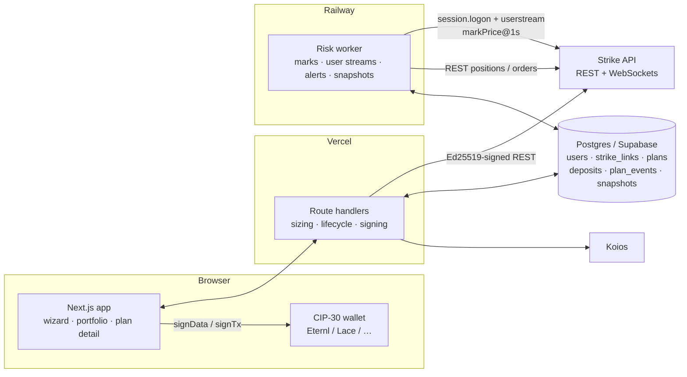

# Locke

**Protect what your business holds. Manage what it needs to buy.**

Locke helps businesses manage price risk using [Strike Finance](https://strikefinance.org) perpetuals. A business tells Locke what it wants to protect — ADA it holds, or the fuel it buys every month — and Locke opens, sizes and monitors a hedge on Strike, presented as a **protection plan**.

It's built for a business that holds part of its treasury in ADA and spends money on diesel: for example, a Cardano stake pool operator running generators through grid outages. Falling ADA shrinks its budget and rising fuel prices raise its costs. Locke manages both exposures from one portfolio, with each plan's margin kept separate.

| Plan | Protects against | Strike market | Side | Hedge quality |
|---|---|---|---|---|
| **Holdings** | A fall in the value of ADA held | `ADA-USD` | Sell (short) | Direct: the hedge tracks the same asset |
| **Operating costs** | A rise in fuel costs | `WTI-USD` | Buy (long) | Partial: crude explains only part of local pump prices |

Every plan follows the same path: **describe exposure → preview scenarios and costs → fund and open → monitor → adjust or close.**

Locke is not a trading terminal. Every screen is about an exposure the business already has.

## What it does

- **One wizard, two plan types.** The holdings form reads the wallet's ADA balance through CIP-30. The costs form takes litres per month, pump price, FX rate, months covered and an explicit *crude share* assumption.
- **Preview before funding.** Locke shows the hedge in plain words, the margin to deposit (USD and ADA), the opening cost (Strike taker fee plus builder fee), funding per day at the live rate ("cost of protection"), and the outcome at −50/−25/−10/+10/+25/+50%. It also shows the price where Locke would ask for a top-up and the estimated liquidation price.
- **Real hedges on Strike mainnet.** One signed ADA deposit, then isolated margin and leverage are set on the market and a market order goes out carrying Locke's builder fee. The buffer margin is added after the fill.
- **Separate margin per plan.** Each plan is an isolated position on its own market, so trouble in one never draws on the other's collateral.
- **Risk worker.** A long-running process streams mark prices and each user's Strike stream. It recomputes every plan's margin ratio once a second and alerts *before* Strike's own levels (details below).
- **One-tap, wallet-signed top-up.** Locke suggests an amount, the wallet signs a Cardano deposit, and once Strike credits it Locke adds it to that plan's isolated margin only.
- **Resize and close.** Holdings plans resize to a new share or ADA amount. Costs plans close one month's worth (S ÷ T) to match fuel used. Close is a reduce-only market order.
- **Replay.** The plan runs against up to 180 days of Strike's daily mark prices, with and without Locke, animated over about 10 seconds with a scrubber.
- **Delegation evidence.** Koios shows the ADA is still staked to its pool and still delegated to its DRep.
- **Withdraw.** Free balance on Strike goes back to the connected wallet, signed by the wallet.

### Risk levels

| Level | Trigger | What Locke does |
|---|---|---|
| Watch | margin ratio ≥ 50% **or** mark within 20% of liquidation | Card turns amber |
| Action needed | margin ratio ≥ 60% **or** mark within 10% of liquidation | Alert with a one-tap top-up |
| Margin call | ratio ≥ 70% (Strike) | Red banner, repeat alert |
| Reduce only | ratio ≥ 90% (Strike) | Strike blocks risk-increasing orders |
| Liquidation | ratio ≥ 100% (Strike) | Strike liquidates; Locke alerts at once |

A plan leaves Watch only when the ratio falls below 45% and the distance rises above 22% (hysteresis).

The distance check exists because margin ratio only rises steeply in the last few percent before liquidation. On a 1x plan, a 60% ratio alert would fire about 0.3% before liquidation, too late for a Cardano deposit to confirm. The suggested top-up is enough to bring the ratio back to 35% *and* push liquidation 25% away from the mark.

### Fuel plans (operating costs)

- **Fuels:** diesel, petrol, kerosene / jet fuel and cooking gas (LPG). LPG counts as two-thirds of a litre of crude per litre, by energy content.
- **Reference prices:** Nigeria, Kenya, Ghana and the Philippines, from GlobalPetrolPrices.com (official and industry sources), snapshot of 19 Oct 2026 with 1-month, 3-month and 1-year history (`src/lib/domain/fuel.ts`). Kenya LPG, Ghana LPG and Ghana kerosene have no current reference; the form asks for the user's price.
- **Calibrated crude share:** crude's cost in a litre (live WTI ÷ 158.987 L × the fuel's crude content × the live exchange rate) over the pump price, clamped to 5–95%. Users can override it and return to the calibrated value.
- **Budget mode:** "keep my monthly bill under X even if crude rises r%". With crude share c, cover s keeps the bill at B × (1 + c·r·(1 − s)), so Locke hedges s = 1 − (X/B − 1)/(c·r) of the crude-linked cost. The server recomputes s from the budget; a budget below today's bill, or one that needs no hedge, is refused with the reason.
- **Exchange-rate warning:** live and 90-day-old dollar rates (open fawazahmed0 currency API via jsDelivr, Cloudflare mirror) show how the currency moved, and what a further 10% fall adds to the bill. A WTI hedge can't cover that, and the form and preview say so.

## Pages

Every feature is its own server-rendered route. Pages load their data on the server, guard by
plan status (a draft can't open the top-up page, for example) and redirect with real HTTP status
codes. A middleware gate sends signed-out visitors to `/connect?next=<page>` and brings them back.

| Route | What it is |
|---|---|
| `/` | Home, with live ADA-USD and WTI-USD marks from Strike |
| `/how-it-works` | The four steps, both plan types, the alert ladder |
| `/connect` | Connect a CIP-30 wallet and sign in through Strike's builder connect |
| `/portfolio` | Total value protected and one card per plan |
| `/protect` | Choose what to protect |
| `/protect/holdings`, `/protect/costs` | Describe the exposure; submitting creates a draft |
| `/plans/[id]/preview` | Hedge, costs, scenarios, safety prices, disclosures |
| `/plans/[id]/fund` | Sign the ADA deposit and follow it until the hedge is open |
| `/plans/[id]` | Overview: headline number, margin health, stats, latest events |
| `/plans/[id]/top-up` | Wallet-signed top-up, added to this plan's margin only |
| `/plans/[id]/resize` | Holdings: new share or amount. Costs: close one month (S ÷ T) |
| `/plans/[id]/close` | Reduce-only close at market |
| `/plans/[id]/replay` | The plan against Strike's real price history |
| `/plans/[id]/activity` | Full event log and margin-ratio history |
| `/plans/[id]/strike` | Raw position fields and deposits with transaction links |
| `/withdraw` | Free balance back to the connected wallet, wallet-signed |
| `/account` | Wallet, stake pool and DRep, Strike balance, sign out |

## Architecture



- **The browser** only ever signs money movements: the builder-connect challenge, each deposit transaction, and each withdrawal.
- **The server** generates one Ed25519 API wallet per user during connect. It encrypts the key with AES-256-GCM and signs routine Strike calls (orders, leverage, margin mode, isolated margin, positions). The private key never reaches the browser.
- **The risk worker** runs the same plan lifecycle code as the API (`src/lib/server/planService.ts`), so a plan finishes opening even if the user closes the tab.

### Code map

| Path | What |
|---|---|
| `src/lib/domain/` | Pure math: sizing, scenarios, crude-share pump model, replay, margin ratio, liquidation and alert prices, risk levels |
| `src/lib/strike/` | Strike REST client and Ed25519 request / `session.logon` signing |
| `src/lib/cardano/` | CIP-30 wallet, bech32, and a byte-preserving CBOR witness merge for Strike's deposit transactions |
| `src/lib/server/planService.ts` | Plan lifecycle state machine (compare-and-set transitions, so two callers never place the same order) |
| `src/app/api/` | Route handlers |
| `src/app/` | Pages (see the table above) and API route handlers |
| `worker/index.ts` | Risk worker |
| `db/schema.sql` | Schema (idempotent) |

## How Locke uses Strike

Every authenticated call goes through the user's builder-connected API wallet and is signed as `METHOD:PATH:TIMESTAMP:NONCE:SHA256(body)`. Every order carries `X-Builder-Fee-Bps`, a server constant at or below the fee share the user approved.

| Step | Endpoint |
|---|---|
| Connect (login) | `POST /auth/builder/request-signature` (`chain: "cardano"`), then `POST /auth/builder/verify-signature` with the CIP-30 `signData` result |
| Market rules | `GET /price/v2/exchangeInfo` (step size, minimum notional), `GET /v2/markets` (margin tiers), `GET /v2/fee-tiers` |
| Live price and funding | `GET /price/v2/markPrice` (`p` mark, `r` hourly funding rate); WebSocket `/ws/price`, `markPrice@1s` |
| Liquidity | `GET /price/v2/depth`: the preview walks the book for the hedge's size (average fill, slippage over the mark); open and resize-up re-read it fresh and refuse a market order the book can't fill within 1% of the mark |
| History | `GET /price/v2/klines?interval=1d&priceType=mark` |
| Deposit | `POST /v2/deposit/quote` (ADA, lovelace) → `POST /v2/deposit/build-tx` (CIP-30 UTxOs) → wallet signs and submits → `POST /v2/deposit` with the tx hash |
| Deposit credited | `GET /v2/history/transaction?type=1` matched by tx hash |
| Balance | `GET /v2/account` |
| Isolated margin | `POST /v2/marginMode` (`isolated`), checked with `GET /v2/symbols` |
| Leverage | `POST /v2/leverage` |
| Open, resize, close | `POST /v2/order` with `X-Builder-Fee-Bps`, `client_order_id = locke-{planId}-{action}-{n}`, `reduce_only` for reductions |
| Add margin | `POST /v2/isoMargin` (`modify_type: "add"`) for the buffer after the fill and for each top-up |
| Positions | `GET /v2/positions?symbol=…` (`iso_balance`, `maintenance_margin`, `liquidation_price`, `accumulated_funding_fees`) |
| User stream | WebSocket `/ws/user-api`: `session.logon`, `subscribe userstream`, `ACCOUNT_UPDATE` and `ORDER_TRADE_UPDATE` |
| Withdraw | `POST /v2/withdraw/quote` → wallet signs `message_to_sign` (and `tx_cbor`) → `POST /v2/withdraw` |

Verified against mainnet while building:

- The user stream answers on `wss://api.strikefinance.org/ws/user-api`; the `api-v2` host in one doc page does not resolve.
- `ADA-USD` mark history starts 2026-03-19 and `WTI-USD` starts 2026-04-23, so both support 180-day replays.
- The reduce-only field is `reduce_only`, and the hourly funding rate is `r` on `markPrice`.

## Run it

Requirements: Node 20+, Postgres (local or Supabase), a builder code from Strike's Builder Dashboard, and a CIP-30 wallet on Cardano mainnet.

```bash
cp .env.example .env.local     # fill in the values below
npm install
npm run db:migrate             # applies db/schema.sql (safe to re-run)
npm run dev                    # app on http://localhost:3000
npm run worker                 # risk worker (separate terminal)
npm run strike:check           # readiness: config, Strike REST/WebSocket, history, liquidity, DB
npm run strike:check -- --signed   # + signed GET /v2/account and user-stream logon (after a wallet connects)
npm test                       # unit tests
TEST_DATABASE_URL=postgres://…/locke_test npm test   # + lifecycle integration test (throwaway DB)
```

### Environment variables

| Name | Where | Purpose |
|---|---|---|
| `STRIKE_API_URL` | app, worker | `https://api.strikefinance.org` |
| `STRIKE_WS_USER_URL` | worker | `wss://api.strikefinance.org/ws/user-api` |
| `STRIKE_WS_PRICE_URL` | worker | `wss://api.strikefinance.org/ws/price` |
| `STRIKE_BUILDER_CODE` | app | Locke's builder code |
| `STRIKE_BUILDER_FEE_BPS` | app, worker | Fee per order, at or below the registered share (max 100) |
| `NEXT_PUBLIC_CARDANO_NETWORK_ID` | app | `1` mainnet (`0` with the testnet API) |
| `KOIOS_URL` | app | `https://api.koios.rest/api/v1` |
| `DATABASE_URL` | app, worker | Postgres URL (the Supabase pooler works) |
| `LOCKE_KEY_ENC` | app, worker | 32 bytes hex; encrypts API wallet keys (`openssl rand -hex 32`) |
| `SESSION_SECRET` | app | At least 32 characters; signs session cookies |
| `LOCKE_DEMO_ALERTS` | app, worker | `true` lowers alert levels for a demo (labelled on screen) |

### Deploy

- **App:** import the repo on Vercel and set the variables above.
- **Worker:** create a Railway service from the same repo. `railway.json` runs `npm run worker`, with a health check at `/healthz`.
- **Database:** create a Supabase project, put its connection string in `DATABASE_URL`, and run `npm run db:migrate` once.

## Security

- The Strike API wallet key is generated on the server, encrypted with AES-256-GCM under `LOCKE_KEY_ENC`, and never sent to the browser or logged. A leaked key could place trades, but it could not move money out: withdrawals need the user's own wallet signature and only go to the connected wallet.
- Login is wallet-signed. Strike verifies the CIP-30 signature over its builder-connect challenge, and Locke issues an HMAC-signed, HTTP-only session cookie.
- State-changing routes check `Origin` against the host, on top of `SameSite=Lax` cookies.
- The server recomputes every order (size, side, symbol, reduce-only) from the stored plan and never trusts sizes from the browser.
- Plan status changes are compare-and-set updates, so retries and races can't double-open or double-close a plan.
- Row-level security is enabled on every table. The app and worker use a server role.

## Known limits

- **Customer validation.** The SPO and Cardano-team customer is a hypothesis that still needs validating with real operators.
- **Basis risk on fuel.** WTI explains only part of local pump prices. The plan is labelled "Partial hedge — crude share only", and the crude share is the user's own assumption.
- **Replay funding.** Strike publishes no funding-rate history, so the replay lines show price effects only. Funding at today's rate is shown alongside as a labelled projection.
- **Cardano only.** Deposits are ADA from a CIP-30 wallet; Solana and Ethereum deposits are out of scope.
- **One plan per market per user.** This comes from isolated margin on the main account. Strike sub-accounts can't be created through the API.
- **Top-ups need a signature.** Locke never moves funds on its own; it alerts early and makes the top-up one tap.

## Disclaimer

Locke is a tool, not financial advice. Hedges can lose money on their own: a holdings hedge gives up upside, and a fuel hedge loses if fuel prices fall. Positions can be liquidated if margin runs out. Strike has eligibility rules, so check Strike's restricted persons policy before using it.
